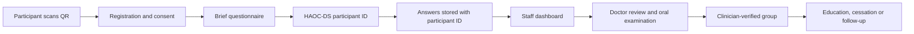
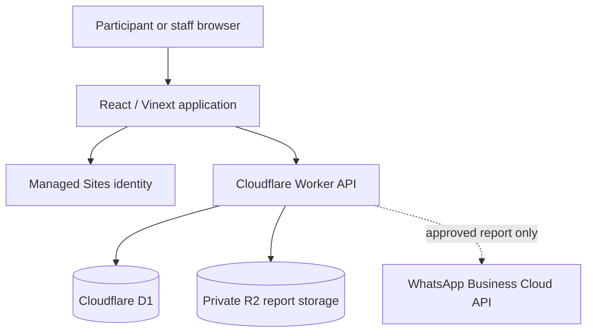

# Telangana Against Oral Cancer — DRIVE SAFE

## Purpose

DRIVE SAFE is the Telangana Against Oral Cancer screening programme for auto and taxi drivers. It supports participant registration, a short oral-health questionnaire, clinician review, classification, follow-up, programme reporting and optional WhatsApp PDF report delivery.

## Participant workflow

1. A participant scans the programme QR code or opens `/register`.
2. They select a preferred language, complete registration and provide required consent.
3. The system creates a random `HAOC-DS-...` participant ID and a short-lived, single-use questionnaire token.
4. The questionnaire opens immediately after registration and is recorded under the same participant ID.
5. The live staff workspace refreshes every 15 seconds while visible, so new registrations and completed questionnaires appear without a manual refresh.
6. A Doctor Admin performs and verifies the oral examination. Questionnaire answers alone never assign a clinical group.
7. The clinician records the habit/lesion matrix group and management pathway:
   - Group 1: no habit, no lesion — education.
   - Group 2: no habit, lesion — clinical lesion pathway.
   - Group 3: habit, no lesion — cessation and planned re-screening.
   - Group 4: habit and lesion — lesion pathway plus cessation.

## Live camp configuration

The initial public QR is configured for:

| Field | Value |
|---|---|
| Camp | Telangana Against Oral Cancer |
| Location | Hyderabad |
| Date | 17 October 2026 |
| Protocol | DRIVE SAFE v1.0 live |
| Registration QR | `/register/qr` |
| Participant entry | `/register` |

The QR opens registration and the questionnaire. It never exposes staff-only fields, past submissions, clinical findings or other participants' records.

## Architecture

| Layer | Responsibility |
|---|---|
| React, TypeScript and Vinext | Campaign pages, participant intake, role dashboards and multilingual user interface. |
| Cloudflare Workers | Server-side API, validation, role checks, session checks, rate limits and audit signing. |
| Cloudflare D1 | Camps, participants, questionnaires, answers, consents, users, sessions, records, audit events and settings. |
| Cloudflare R2 | Private generated or uploaded report objects. |
| Sites identity | Authenticated staff identity and site access policy. The application does not store passwords. |
| WhatsApp Business API | Optional clinician-reviewed PDF delivery after specific WhatsApp consent and final provider setup. |

The hosting manifest binds D1 as `DB` and R2 as `BUCKET`. Sensitive runtime values such as the audit key and WhatsApp token are hosting secrets, never browser code or source-controlled configuration.

## Access model

| Role | Permitted work |
|---|---|
| Super Admin | User access, role management, settings, audit access, QR management, logical exports and technical administration. |
| Doctor Admin | Participant records, questionnaire review, clinical examination, clinician verification and patient reports. No user or system-settings management. |
| Assistant | Read-only authorised participant/screening data, analysis and de-identified reporting. No clinical changes, user management or system settings. |

Initial Super Admin accounts are provisioned from `ADMIN_EMAILS`. Initial Doctor Admin accounts are provisioned from `DOCTOR_ADMIN_EMAILS`. On first sign-in, the application creates the matching account from the managed identity email. Later account management occurs through the Super Admin workspace.

## Security and privacy controls

- Server-side role and permission validation protects every API route. Hiding a dashboard control is not the security boundary.
- Staff sessions use random tokens stored only as SHA-256 hashes. Production cookies are Secure, HttpOnly and SameSite=Strict.
- Default session policy is 15-minute idle expiry and 8-hour absolute expiry. Role changes can revoke sessions.
- Sensitive API responses use `Cache-Control: no-store, private`; origin and JSON-content checks protect mutations.
- Public intake accepts only registration and questionnaire submission. It has bounded request bodies, rate limiting, approved protocol checks and short-lived one-time tokens.
- Participant answer values use canonical data values so reporting stays consistent across languages.
- No Aadhaar number, full home address or lesion photographs are collected by the registration workflow.
- The QR contains only the public registration URL. Patient-specific QR values are revocable hashes and still require staff authorization.
- The public privacy notice states that name, mobile number, screening answers and clinician findings are used for screening, follow-up and programme evaluation by authorised personnel.

## Audit trail

Important events are written to the append-only `audit` table. Each live event includes:

- audit event ID;
- tenant and optional participant ID;
- acting account or controlled public-entry actor;
- action description;
- timestamp; and
- HMAC-SHA-256 signature derived from the protected `AUDIT_KEY`.

Examples include registration, consent capture, questionnaire submission, patient record views, clinician actions, access denials, session events, account changes, exports and WhatsApp report-submission requests. Demonstration-mode events are explicitly marked `DEMO` and use separate per-user tenants.

Consent records are also append-only and retain the consent type, status, wording version, time, actor and capture method. The WhatsApp report consent is separate from screening consent and can be withdrawn.

## Current operational status

| Area | Status |
|---|---|
| Staff access | Enabled |
| Public participant intake | Enabled |
| Hyderabad 17 October 2026 camp | Configured |
| DRIVE SAFE v1.0 live questionnaire | Approved and configured |
| Multilingual interface | Enabled with English fallback for missing or unreviewed clinical copy |
| WhatsApp PDF delivery | Implemented but disabled until Meta Business credentials and an approved template are configured |
| Doctor referrals, samples and laboratory user workflows | Retired from the active UI; historical records remain protected |

## Remaining operational work

- Configure WhatsApp Business phone-number ID, approved document-header template, access token and supported Graph API version before enabling WhatsApp delivery.
- Define data retention, correction/deletion handling, encrypted backup destination, restore drills and ownership.
- Complete real-device camera QR testing, accessibility testing, production penetration testing and load testing.
- Keep the staff access roster current and remove accounts promptly when access is no longer required.
